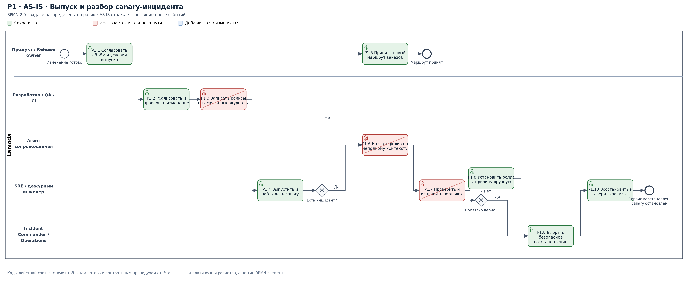
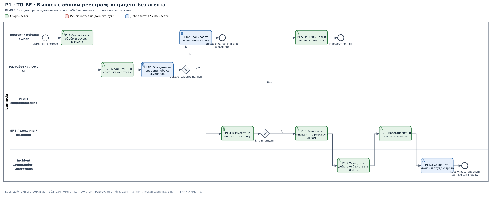
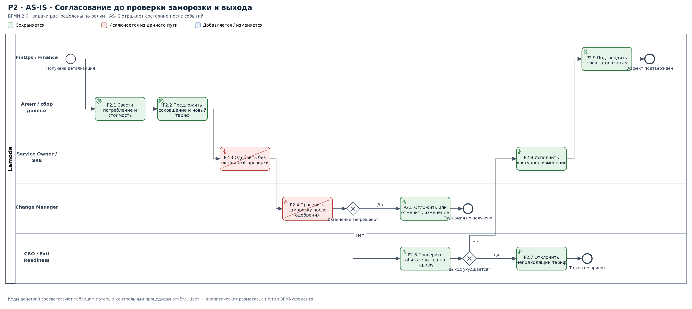
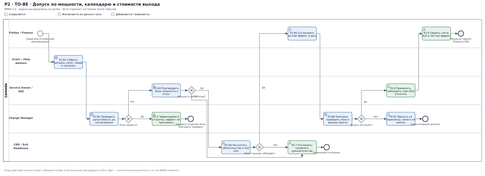
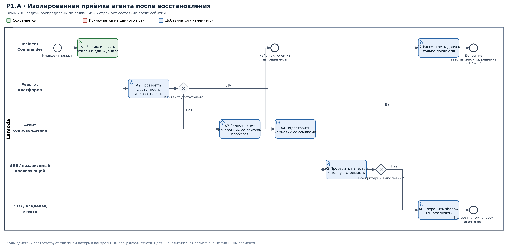

# Lamoda: устойчивость заказного контура и управляемая оптимизация облачных расходов

## Паспорт проекта

| № | Параметр | Значение |
|---:|---|---|
| 1 | Бизнес | Lamoda (ООО «Купишуз»), электронная коммерция и fashion-ритейл |
| 2 | Масштаб | 117,6 млрд ₽ выручки ООО «Купишуз» за 2025 год, бухгалтерская отчётность по РСБУ. В источнике — 117 587 001 000 ₽; для сопоставимости сохранена округлённая база 117,6 млрд ₽ [1]. |
| 3 | Направления выручки | Продажа собственного ассортимента, маркетплейс сторонних продавцов, услуги продавцам; маркетплейс — 57% NMV в 2025 году [2]. |
| 4 | ИТ-функция | Более 1300 сотрудников Lamoda Tech [3]; состояние — партнёр, зона **красная** в рассматриваемом сценарном состоянии. |
| 5 | Ограничения на раскрытие | Внутренние журналы изменений и инцидентов, трудозатраты, облачные счета, условия обязательств и детализация ИТ-бюджета недоступны. Внешние ориентиры, обстоятельства сценария и проектные нормативы разделены. |

**Дата решения:** 3 ноября 2026 года.  
**Инициатор:** технический директор (CTO).  
**Участники принятия решений:** COO, CFO, руководитель рисков, Incident Commander, владельцы сервисов и команда Exit Readiness.  
**Горизонт:** ноябрьская распродажа, декабрьское тестовое восстановление и последующие 12 месяцев. Финансовый результат до конца 2026 года показан отдельно от годового темпа экономии.

## 1. Решение руководства

Предлагается сохранить развитие независимого маршрута заказов **H3**, но исключить агентный разбор из оперативного восстановления. До завершения декабрьского испытания Incident Commander и SRE работают по неагентному runbook. Агент допускается только к изолированной проверке уже закрытых инцидентов: его ответ не задерживает диагностику, откат или восстановление.

По **H4** сохраняется анализ облачного потребления, но согласование владельцем сервиса больше не является достаточным основанием для изменения инфраструктуры. До исполнения обязательны проверка календаря заморозки, испытанного запаса мощности, условий выхода от поставщика и чистого финансового результата. Новые обязательства по объёму не принимаются, пока не доказано соблюдение лимита стоимости выхода.

**Обещание компенсировать 150 млн ₽ исключительно средствами FinOps снимается.** Даже полная реализация прежней цели 5% при уточнённой тарифной базе даёт 70 млн ₽ годовой экономии до затрат на внедрение. При отсрочке результат первого года ещё меньше. CFO должен планировать непокрытую доплату отдельно, не изымая средства из восстановления OMS и обеспечения распродажи.

| Решение | Кто отвечает | Контрольный результат |
|---|---|---|
| Удалить агентный ответ из обязательного пути обработки инцидента | Incident Commander | Runbook и схема P1 не содержат ожидания или проверки черновика до восстановления |
| Объединить сведения о выпусках Legacy OMS и нового контура, сохранив исходные журналы | Release Manager и руководитель платформы | Для каждого выпуска доступен проверяемый пакет версии, времени, окружения и изменений |
| Оценивать агента по стоимости принятого результата, включая отклонённые черновики | Владелец агента и SRE lead | Протокол сравнения с самостоятельным разбором; решение о сохранении или отключении |
| Проверять допустимость FinOps-мер до затрат на полное согласование | FinOps lead и Change Manager | Заблокированные меры получают статус `deferred` или `rejected`, а не обещанную экономию |
| Защитить запас мощности и переносимость | Service Owner, SRE, CRO | Нет сокращения защищённых ресурсов и новых нерассчитанных обязательств |
| Отразить непокрытую доплату в финансовом плане | CFO; утверждение CEO | Отдельная строка финансирования, не зависящая от недоказанной экономии |

Решения ниже являются предлагаемым порядком управления. Они не означают, что проверки уже выполнены, показатели достигнуты или финансирование согласовано.

## 2. Исходное состояние и единая расчётная база

### 2.1. Установленные обстоятельства

| Код | Обстоятельство | Статус и ограничение использования |
|---|---|---|
| S1 | Предшествующий отказ остановил обработку заказов на 24 часа; запуск продукта перенесён на шесть месяцев | Состоявшийся сценарный исход. 24 часа — один случай, не среднее время восстановления и не оценка частоты отказов. |
| S2 | Агент дважды связал сбой с неверным релизом; журналы Legacy OMS и CI/CD раздельны | Состоявшееся событие. Доля ошибок неизвестна без числа всех проверенных черновиков. |
| S3 | Проверка черновиков обходится SRE по времени дороже самостоятельного разбора | Качественный результат наблюдения. Он устанавливает отрицательный эффект текущей схемы, но не задаёт минуты потерь. |
| S4 | Большинство одобренных FinOps-изменений отменено или отложено из-за заморозки | Состоявшееся событие. Число рекомендаций и даты исполнения не представлены; процент реализуемости не назначается. |
| S5 | Обязательство объёма увеличивает стоимость выхода; служба рисков уже ввела ограничение | Состоявшееся условие. Сам численный лимит `E_max` не сообщён. До его предъявления новые увеличивающие зависимость обязательства не допускаются. |
| S6 | Действует переходный тариф **+40%**, на **150 млн ₽ в год** дороже обсуждавшегося варианта **+25%** | Уточнённое сценарное состояние. Вариант +25% используется только как сравнение, не как действующий договор. |

Публичные материалы Lamoda подтверждают использование деплойных тикетов, уведомлений о выпусках и согласованного календаря значимых изменений [4]. Поэтому предлагается связать существующие источники, а не заменять их ещё одним несогласованным журналом. Исторические публикации не доказывают фактические длительности процессов в ноябре 2026 года.

### 2.2. Тарифная база

При одинаковом годовом объёме услуг и одинаковом периметре двух предложений:

```text
(1,40 − 1,25) × C₀ = 150 млн ₽
C₀ = 150 / 0,15 = 1 000 млн ₽/год
Cпереход = 1,40 × C₀ = 1 400 млн ₽/год
Cальтернатива = 1,25 × C₀ = 1 250 млн ₽/год
```

Сумма 1 млрд ₽ здесь **выведена из сценарной разницы**, а не представлена как публично раскрытые расходы Lamoda. CFO проверяет сопоставимость объёма, состава услуг и налогового представления. Если разница 150 млн ₽ включает иные компоненты, обратный расчёт заменяется фактической детализацией договора.

### 2.3. Связь с действующими инициативами

| Процесс | Сохраняемая гипотеза | Принятый бизнес-результат | Что больше не считается результатом |
|---|---|---|---|
| **P1. Выпуск изменений и сопровождение нового маршрута заказов** | **H3:** запуск нового продукта без полной замены Legacy OMS | Новый маршрут принят бизнесом, безопасен для заказов и восстанавливается без ушедших специалистов | Количество черновиков агента; наличие оркестратора без проверки остаточной зависимости |
| **P2. Допуск и исполнение оптимизаций облачных расходов** | **H4:** снижение сопоставимых расходов без нарушения надёжности и переносимости | Изменение исполнено, эффект подтверждён счетами и превышает полную стоимость выполнения | Сумма найденной или согласованной, но не реализованной экономии |

H1 — подбор размера — сохраняется в портфеле, но не получает дефицитных SRE-ресурсов, зарезервированных для распродажи и восстановления. Его собственный эффект в данном документе не пересчитывается.

## 3. Обозначения и правила моделирования

Схемы выполнены в **BPMN 2.0**: пул обозначает Lamoda; дорожки — внутренние роли и автоматизированные функции. Окружности обозначают события, задачи — скруглённые прямоугольники, ромб с X — исключающий шлюз. Между дорожками одного пула идут потоки управления, а не потоки сообщений [15].

**Зелёные задачи сохраняются; красные с диагональным зачёркиванием исключаются из соответствующего пути; синие добавляются или существенно меняются.** AS-IS показывает процесс после новых событий и до предлагаемого исправления. Удаление задачи из оперативного пути не обязательно означает удаление возможности: агент P1, например, переносится в отдельную процедуру приёмки после восстановления.

Роли, ветвления и коды задач в схемах соответствуют таблицам ниже. Последовательность, не установленная непосредственно событием, является организационной моделью для согласования с владельцем процесса.

## 4. P1 — выпуск изменений и сопровождение заказного контура

### 4.1. Процесс до изменения



[Редактируемая модель BPMN](assets/p1_asis.bpmn) · [Векторная схема SVG](assets/p1_asis.svg)

При сбое агент получает неполную картину выпусков, формирует ошибочную привязку, а SRE проверяет ответ и повторяет часть расследования. Сохраняется человеческое решение о восстановлении, но до него добавляется непродуктивная работа. Два ошибочных ответа не доказывают, что произошло два неудачных деплоя: ошибки агента и ошибки выпуска учитываются раздельно.

### 4.2. Процесс после изменения



[Редактируемая модель BPMN](assets/p1_tobe.bpmn) · [Векторная схема SVG](assets/p1_tobe.svg)

Сведения о выпусках обоих контуров объединяются в проверяемое представление. Сохраняются исходные записи и ссылки на них. Обязательные поля: `deployment_id`, `system`, `environment`, `artifact_version`, `commit/config_version`, время начала и завершения с часовым поясом, результат, инициатор, состав затронутых компонентов и идентификатор изменения. Для Legacy OMS допускается идентификатор, сформированный адаптером журнала; он не должен выдаваться за идентификатор CI/CD.

Отсутствующая запись или противоречивое время не заменяются догадкой. Для планового расширения canary неполный пакет блокирует допуск. При уже возникшем инциденте неполный реестр **не блокирует восстановление**: Incident Commander использует исходные журналы, безопасный runbook и доступные доказательства. Близость выпуска по времени рассматривается как кандидат на проверку, а не доказанная причина.

### 4.3. Таблица потерь и ожидаемое изменение времени

`A` — активное рабочее время; `W` — ожидание. Оба показателя фиксируются отдельно. Календарное ожидание параллельных работ не суммируется механически: длительность процесса рассчитывается по критическому пути, трудозатраты — по сумме worklog.

| Этап / потеря | До изменения: A и W | После изменения: A и W | Основание и способ проверки |
|---|---|---|---|
| **P1.1–P1.2. Оценка, согласование, реализация** | Фактические A и W не предоставлены. Внешняя публикация подтверждает наличие согласования, но не его длительность [4]. | Работа анализа и тестирования сохраняется. Новая проверка пакета учитывается как дополнительное A; снижение W заранее не заявляется. | Трекер изменений: `ready_for_review`, `review_started`, `approved`; worklog. Владелец — Release Manager. Срез **05.08–02.11.2026**, 90 календарных дней; период выбран для сопоставления нескольких циклов выпуска. |
| **P1.3. Раздельный учёт выпусков** | Два источника, несвязанные идентификаторы. Время сопоставления `A_join` измеряется по обоим ошибочным кейсам и новым случаям. | Автоматическое связывание полей; при несоответствии — явный пробел. `A_after = A_exception`, машинное время измеряется отдельно. | Журнал адаптеров и проверка ссылок; владелец — Release Manager. Потеря: повторный поиск версии и перепроверка причин. |
| **P1.4. Ожидание окна выпуска** | Исторический аналог заказной системы: **2 выпуска в неделю** [5]. При равномерных окнах расчётное W = **42 календарных часа**; это не текущий замер. | Вне заморозки предлагается проверяемый режим одного допустимого окна в день: расчётное W = **12 часов**. Снижение на 30 часов возможно только при подтверждении обоих режимов. | `ready_for_release → deployment_started`; отделить согласование от ожидания расписания. Модель и её ограничения приведены ниже. |
| **P1.6–P1.7. Агент и проверка черновика** | Установлено `A_check + A_fix > A_manual`. Численные минуты неизвестны. Ожидание модели `W_model` учитывается дополнительно, если оно блокировало человека. | В оперативном пути **0 минут ожидания агента и 0 минут проверки его черновика по проекту**. Самостоятельный разбор сохраняется; offline-проверка относится к отдельным расходам. | Worklog SRE, версии черновиков, время принятия/отклонения. Владелец — SRE lead. Отрицательная полезность нынешнего варианта установлена без вымышленного процента ошибок. |
| **P1.8–P1.9. Диагностика и решение** | Самостоятельное расследование выполняется после затрат на неверный ответ или вместо него. A и W восстанавливаются по timeline. | Разбор начинается сразу по проверяемым источникам. IC утверждает действие; агент не является согласующим. | Incident timeline, сообщения командного канала, смены статуса. Ответственный — Incident Commander. |
| **P1.10. Восстановление и сверка** | **24 часа** — полный интервал одного предшествующего отказа; доли A и W не установлены. | **RTO ≤4 часа, RPO ≤5 минут** — ранее принятые требования, не достигнутые значения. Раздельный хронометраж на декабрьском испытании. | Начало отказа, начало работ, ожидание доступа/решения, операции восстановления, сверка платежей и открытие трафика. Владелец — COO / IC. |
| **P1.N3. Эталонный разбор после восстановления** | Расход на повторные проверки не обособлен. | Дополнительная постоянная работа: разметка причин, принятие результата и обновление реестра. Не считается бесплатной. | Worklog проверяющего, число принятых разборов, стоимость API; формула в разделе 6. |

**Расчёт исторического ориентира очереди.** В описании опыта работы с заказной системой Lamoda автор указывает два выпуска в неделю; статья опубликована в 2020 году и описывает более ранний опыт [5]. Для модели с одинаковыми интервалами и равномерным поступлением готовых изменений:

```text
Интервал между окнами = 7 × 24 / 2 = 84 часа.
Среднее ожидание окна = 84 / 2 = 42 часа.
Одно окно в день: 24 / 2 = 12 часов.
Условное снижение ожидания расписания = 42 − 12 = 30 часов на изменение.
```

Это **аналитический ориентир низкой переносимости**, а не характеристика действующего CI/CD. Он не включает длительность разработки и не равен DORA change lead time. При неравномерных интервалах `d_j` среднее ожидание рассчитывается как `Σd_j² / (2Σd_j)`; во время заморозки добавляется фактическое ожидание разрешённого окна. Ежедневное окно — предлагаемое правило планирования, разрешаемое только при достаточной инженерной мощности и сохранении качества.

Для каждого экземпляра процесса дополнительно рассчитывается `доля ожидания = W / (A_elapsed + W)`. `A_elapsed` — неперекрывающаяся длительность активных стадий по критическому пути; она не подменяется суммой часов нескольких специалистов. До получения журнала фактическая доля ожидания остаётся неизвестной.

### 4.4. Восстановление до декабрьского испытания

Рабочая последовательность: Incident Commander объявляет инцидент и останавливает расширение canary; SRE проверяет состояние обоих контуров и применяет заранее проверенный откат либо восстановление; Operations сверяет заказы, резервирование и платёжные состояния; трафик открывается поэтапно после подтверждения целостности. Если независимый маршрут не доказан, его наличие не используется как основание продолжать небезопасные операции.

Цель декабрьского испытания — подтвердить восстановление без ушедших специалистов и без агента. Наличие одинаковой суммы платежей недостаточно: проверяются идентификаторы, дубли и пропуски. **Любой двойной платёж или необъяснённая потеря принятого заказа блокирует приёмку.**

RTO 4 часа не следует смешивать с историческим показателем доступности Lamoda 99,95% за год: в публичной статье это разные по смыслу величины [6]. Успешный четырёхчасовой тест не отменяет уже произошедший суточный простой.

## 5. P2 — облачные расходы, заморозка и допустимость выхода

### 5.1. Процесс до изменения



[Редактируемая модель BPMN](assets/p2_asis.bpmn) · [Векторная схема SVG](assets/p2_asis.svg)

Агент предлагает изменение, владелец затрачивает время на одобрение, после чего выявляется запрет по календарю либо конфликт с Exit Readiness. Допустимость рекомендации проверяется слишком поздно. Экономический результат не возникает, хотя работа агента, владельца и инженеров уже оплачена.

### 5.2. Процесс после изменения



[Редактируемая модель BPMN](assets/p2_tobe.bpmn) · [Векторная схема SVG](assets/p2_tobe.svg)

Календарь проверяется до подробного согласования и повторно непосредственно перед исполнением. Устаревшее согласование не даёт права менять ресурс. Изменение переводится в `deferred`, если окно закрыто, и повторно проходит проверку после открытия окна. Ветвь отсрочки завершает текущую попытку, а не создаёт ложное событие «экономия получена». Повторная попытка сохраняет `recommendation_id` и получает новую версию: повторное согласование не увеличивает сумму эффекта.

**Режим заморозки.** Защищёнными считаются ресурсы нового маршрута заказов, общие с ним хранилища, сети, очереди и мощности для отката и восстановления. Чтение биллинга и анализ разрешены. Сокращение ресурса вне защищённого периметра возможно только при доказанном отсутствии общей зависимости и штатном согласовании. Исключения из заморозки применяются для устранения инцидента или дефицита мощности, а не для выполнения финансового KPI.

### 5.3. Таблица потерь и времени

| Этап / потеря | До изменения: A и W | После изменения: A и W | Основание и получение данных |
|---|---|---|---|
| **P2.1. Получение детализации** | CSV регулярного экспорта обновляется **раз в час**; данные потребления могут приходить с задержкой в несколько часов [7][8]. Внутренняя периодичность обработки Lamoda неизвестна. | Получение по событию обновления объекта. Исключается ожидание собственного пакетного запуска, но задержка поставщика сохраняется. | `usage_at → export_updated_at → ingestion_finished_at`. Владелец — Billing owner. Период **01.09–31.10.2026**: два завершённых месяца. |
| **P2.2. Аллокация и предложение** | Время ручного исправления владельцев и повторных расчётов не представлено. Нельзя считать весь экспорт «готовой рекомендацией». | Сбор доказательств автоматизирован; `A_after = A_exception + A_acceptance`. Отдельно учитываются машинное время и стоимость модели. | Billing lines, resource inventory, tags, карточки рекомендаций и worklog. FinOps lead. |
| **P2.3–P2.4. Одобрение до проверки окна** | Для впоследствии заблокированной меры потери равны `A_owner + A_SRE + A_rework`; затем W до открытия окна. Факт лишнего согласования установлен, минуты неизвестны. | До полной приёмки выполняется проверка календаря. Для заблокированной меры детальное согласование **не запускается**; остаются автоматическая проверка и обслуживание исключений. | `proposed_at`, `approval_started/ended`, `blocked_at`, `eligible_from`; Change Manager. |
| **P2.5. Отсрочка** | Ожидание не учтено в годовом эффекте. | `W = max(0, разрешённая_дата − дата_готовности)`. Экономия до фактического исполнения равна нулю. | Календарь нагрузочных испытаний и распродажи, разрешение на снятие freeze. Даты фиксирует CTO / Change Manager, не агент. |
| **P2.N3–N4. Мощность и стоимость выхода** | Риск обнаруживается после одобрения владельца. | Добавляется постоянное A проверки capacity и обязательств. Положительная экономия после этих затрат является условием допуска. | Capacity-тест, контракт, exit-модель и worklog; SRE и CRO. |
| **P2.8. Применение и откат** | Часть изменений отменена или отложена; внедрённый объём не установлен. | Только актуальный допуск; применение через воспроизводимое изменение конфигурации. При нарушении SLO — откат, расходы на него включаются в результат. | Журнал изменений, состояние ресурса до/после, мониторинг и worklog. |
| **P2.9. Финансовая приёмка** | Потенциал мог восприниматься как годовая экономия независимо от даты внедрения. | Принимается результат за фактически прошедшие периоды; текущий bill предварительный, закрытый период сверяется с документами. | Связка `recommendation_id → change_id → resource/SKU → billing period`; Finance. |

**Расчётная оценка задержки данных.** При ежечасном экспорте и равномерном поступлении начислений только ожидание ближайшего обновления составляет в среднем `1 час / 2 = 30 минут`. Это компонент технической задержки, а не гарантированная свежесть биллинга. Если внутренний сбор выполняется раз в сутки, он добавляет в среднем `24 / 2 = 12 часов`; если раз в час — 30 минут. Существование именно суточного сбора Lamoda не подтверждено, поэтому 12 часов не включаются в заявленную экономию. По событиям обновления собственное ожидание расписания устраняется по конструкции, а длительность загрузки измеряется.

### 5.4. Контроль мощности

Утилизация в обычный час не доказывает избыточность ресурса перед распродажей. Для каждой группы однородных ресурсов:

```text
n_min = ceil(L_design / q_verified) + n_failure_reserve
```

`L_design` — согласованная нагрузка распродажи с одновременно требуемой нагрузкой теста/отката; `q_verified` — испытанная производительность экземпляра при соблюдении SLO; `n_failure_reserve` — резерв для принятого сценария отказа. Если нагрузки взаимоисключающие, берётся максимум, если одновременные — их сумма. Значения не назначаются универсальным процентом.

До подтверждения этих величин сокращение защищённой группы запрещено. Стоимость сохраняемого резерва учитывается как `Σ(сохраняемые экземпляры × цена единицы × период)`. Это цена обеспечения доступности, а не автоматически устранимые потери.

### 5.5. Контроль обязательств

Предложение по тарифу рассматривается отдельно от сокращения потребления. Проверяются минимальный платёж, срок, переносимость обязательства, допустимость изменения типа ресурса, обязательные платежи при выходе и взаимное влияние двух оптимизаций. FinOps Foundation отдельно указывает на риск двойного счёта и оплаты обязательства даже после удаления соответствующих ресурсов [10].

Допуск возможен при одновременном выполнении:

```text
E_after ≤ E_max
Срок выхода_after ≤ утверждённый срок выхода
Чистый эффект за фактический горизонт > 0
```

Пока значение `E_max` и структура текущего exit cost не предъявлены, действует консервативное решение: **не создавать новые обязательства, увеличивающие стоимость выхода**. Ранее обсуждавшиеся суммы выхода не используются как проверенный контрактный факт.

Дополнительная стоимость выхода включает только неизбежные новые обязательства и дополнительные расходы миграции. Штраф и оставшиеся минимальные платежи не складываются, если по договору применим только один из них. Остаток обязательства не вычитается дважды: в текущем P&L отражаются платежи периода, в инвестиционной модели — ещё не учтённая нагрузка будущего выхода.

## 6. Агенты: границы, приёмка и стоимость

### 6.1. Ответственность

| Параметр | Агент P1 | Агент P2 |
|---|---|---|
| Разрешённая задача | После восстановления подготовить хронологию, кандидатов на связь с выпуском и ссылки на доказательства | Сформировать карточку применимой меры с датой исполнения, workload, ценой, ограничениями и расчётом |
| Что видит | Read-only реестр двух контуров, обезличенные логи и эталонный инцидент | Read-only billing, inventory, календарь freeze, SLO, capacity-профиль и согласованные параметры договора |
| Что делает | Создаёт версионированный черновик; при неполноте явно воздерживается от вывода | Создаёт/обновляет рекомендацию и её статус; арифметику выполняет детерминированный расчётчик |
| Кто принимает | SRE проверяет факты; IC принимает финальный разбор; CTO совместно с IC решает вопрос допуска | FinOps lead принимает расчёт, Owner/SRE — безопасность, CRO — exit-условия, Finance — эффект |
| Что не делегируется | Установление причины как окончательного факта, изменение runbook, рестарт, rollback, платёжные действия | Выключение ресурсов, изменение квот, покупка тарифа, подписание обязательства, снятие freeze |
| Отказ | Неагентный процесс продолжается; черновик не обязателен | Ручной анализ или отсрочка; инфраструктура остаётся без изменения |
| Защита данных | Нет платёжных реквизитов и персональных данных; минимальные права, журнал доступа, версии входов и модели | Нет секретов управления; разделены чтение расходов и изменение инфраструктуры |

Текст из логов и внешних документов рассматривается как данные, а не инструкция агенту. Сбор доказательств, проверка идентификаторов, тарифные расчёты и запреты реализуются детерминированно. Генеративная модель используется для текста и объяснений, а не для разрешения опасного действия.

### 6.2. Приёмка агента P1 вне оперативного процесса



[Редактируемая модель BPMN](assets/p1_shadow.bpmn) · [Векторная схема SVG](assets/p1_shadow.svg)

Контрольный набор включает оба ошибочных случая, изменения Legacy OMS, изменения нового контура, параллельные выпуски и случаи без доказанной связи с релизом. Эталон утверждает IC. Сравнение выполняется на закрытых кейсах с распределением между сопоставимыми проверяющими, чтобы знание готового ответа не искажало время ручного пути. Качество и затраты считаются по всем попыткам, в том числе отклонённым и завершённым ручным разбором.

**Критерии допуска:**

1. В контрольном наборе нет критических ошибок — неверной привязки как установленного факта, выдуманного доказательства или опасного действия. Любая такая ошибка возвращает версию на доработку.
2. Все фактические утверждения имеют проверяемые ссылки; при неполноте вывод помечен как неподтверждённый. Сам факт наличия ссылки не подтверждает причинность.
3. Стоимость одного принятого IC результата ниже самостоятельного разбора при сопоставимом качестве. Экономия не достигается за счёт пропуска обязательных проверок.
4. Декабрьское восстановление успешно выполнено без агента. До него агент в оперативный runbook не возвращается даже при успешной offline-проверке.

**Допустимая доля критических ошибок в приёмочном наборе — 0%.** Это правило допуска версии, не утверждение о нулевой вероятности ошибок в эксплуатации. Два известных сбоя записываются как `2 / N_checked`, причём до получения знаменателя процент не публикуется.

Для нуля ошибок в `n` независимых сопоставимых испытаниях односторонняя верхняя 95%-ная граница равна `1 − 0,05^(1/n)` [11]. Например, при `n=60` она составляет **4,87%**, при `n=299` — около **1,00%**. Это иллюстрация неопределённости, а не назначенные объёмы пилота. Повторные прогоны одного инцидента не считаются независимыми случаями. Если выборка не позволяет обосновать приемлемое качество, агент остаётся в shadow-режиме; календарный срок не заменяет доказательство.

### 6.3. Норматив времени проверки

Фиксированное число минут не назначается до хронометража сопоставимого ручного разбора. Вместо коэффициента «вдвое быстрее» используется вычисляемая граница безубыточности.

Для одинаковой ставки проверяющего, в минутах:

```text
t_check,max = t_manual − t_context − t_fix − t_fallback
              − (c_model + c_platform + c_quality_allocated) / r_min
```

`t_manual` — активные минуты самостоятельного принятого разбора; остальные времена — подготовка контекста, исправления и ручное завершение при отказе агента; денежные расходы распределяются по всему потоку, а не только по удачным ответам. Для разных ролей сравниваются рублёвые суммы, а не минуты.

Если `t_check,max ≤ 0`, агент экономически нецелесообразен для данной категории. Если проверка достигла границы без достаточных доказательств, черновик отклоняется: контроль не сокращается ради формального соблюдения лимита. Понесённые затраты сохраняются в оценке пилота. Категории с отрицательным результатом исключаются из агентного маршрута.

**В оперативном runbook текущий норматив ожидания и проверки агента равен нулю: эти задачи из него исключены.** Offline-проверка проводится отдельной назначенной работой, а не за счёт дежурства во время инцидента.

### 6.4. Цена приёмки и единица результата

Внешний зарплатный ориентир — 270 тыс. ₽ в месяц для разработчиков Москвы в I полугодии 2026 года [12]. Это не фактическая полная ставка SRE Lamoda. Для прозрачной чувствительности применяется плановая единица **160 рабочих часов**: `4 недели × 5 дней × 8 часов`. Она не заменяет производственный календарь и расчёт работодателя.

```text
r_proxy = 270 000 / 160 = 1 687,50 ₽ за час = 28,125 ₽ за минуту.
```

| Суммарная активная проверка | Зарплатный эквивалент по внешнему ориентиру |
|---:|---:|
| 5 минут | 140,63 ₽ |
| 10 минут | 281,25 ₽ |
| 20 минут | 562,50 ₽ |
| 30 минут | 843,75 ₽ |

Минуты в этой таблице — **ось чувствительности**, не фактический замер и не предложенный норматив. Для финансового решения используются реальные полные ставки, все проверяющие, API, платформа и поддержка.

```text
C_accept = Σrole (часы_приёмки_принятых_попыток_role × полная_ставка_role)
C_agent_process = C_accept + C_rejected + C_fallback + C_model
                  + C_registry + C_monitoring + C_maintenance
Стоимость принятого результата = C_agent_process / N_accepted
```

Часы принятых попыток, отклонённых попыток и ручного завершения распределяются по непересекающимся категориям; один worklog не включается в несколько слагаемых. При `N_accepted=0` положительный эффект не заявляется. Для P1 принимается итоговый разбор, утверждённый IC; для P2 — исполненная безопасная мера с финансовой сверкой. Принятая текстовая рекомендация и принятый бизнес-результат — разные статусы.

Из установленных `A_check + A_fix > A_manual` уже следует, что нынешний агент P1 увеличивает прямой труд. Дополнительные расходы модели усиливают этот вывод. Размер убытка в рублях определяется после выгрузки worklog; он не подменяется выдуманной средней длительностью.

Для P2 верхняя цена проверки отдельной меры ограничивается её **чистым эффектом за оставшийся доступный период**, а не годовым потенциалом. При нулевом доступном периоде подробное согласование откладывается. Контекст freeze и договора проверяется до дорогой генерации и ручного анализа.

## 7. Финансовый эффект, исходная точка и компромиссы

### 7.1. P1: раздельная оценка восстановления, агента и нового продукта

Сокращение продолжительности одного сопоставимого отказа при выполнении цели:

```text
24 − 4 = 20 часов; 20 / 24 = 83,33%.
```

Это условный результат декабрьского испытания, а не годовая экономия. При базе 117,6 млрд ₽ средний объём выручки за 20 часов составляет:

```text
117,6 млрд / 365 × 20 / 24 = 268,49 млн ₽.
```

Сумма характеризует масштаб экспозиции, **не предотвращённую потерю и не прибыль**. Для финансового эффекта нужны фактический поток заказов, доля необратимо потерянных продаж, признанная выручка на заказ и маржинальный доход. Оборот продавцов маркетплейса не считается выручкой Lamoda целиком.

Эффект агента считается отдельно: `затраты ручного принятого разбора − все затраты агентного пути`. Сейчас знак отрицательный. Переход в shadow не включается в экономию годового ИТ-бюджета: он прекращает дополнительную нагрузку оперативного пути, но оставляет затраты оценки.

H3 сохраняется как гипотеза независимости запуска. Финансовый результат нового продукта по-прежнему определяется его собственными продажами и полной стоимостью контура. Устранение агента не создаёт автоматически 1,2% или 3% выручки.

### 7.2. P2: что означает прежняя цель 5% при действующем тарифе

```text
Годовой расход по переходному тарифу: 1 400 млн ₽.
5% этого расхода: 70 млн ₽/год.
Рост против исходного тарифа: 1 400 − 1 000 = 400 млн ₽/год.
Компенсация всего роста: 70 / 400 = 17,50%.
Компенсация доплаты за переходный вариант: 70 / 150 = 46,67%.
```

**5% не покрывают 150 млн ₽ даже при немедленном исполнении всех мер.** Для такого покрытия при полном годе понадобилось бы `150 / 1 400 = 10,71%` расходов до учёта проверки и внедрения. Это превышает принятый ориентир одного улучшения затрат 1–8%; достижимость не предполагается.

Порог 5% сохраняется только как условный технический ориентир снижения сопоставимого годового темпа расходов после снятия ограничений. Он больше не является обещанием результата текущего финансового года или источником покрытия всего дефицита.

### 7.3. Дата исполнения и реализуемость

Для сценария, в котором весь объём цели 5% действительно доступен после единой отсрочки `d` месяцев:

```text
S_12(d) = 70 × (12 − d) / 12 млн ₽, 0 ≤ d ≤ 12.
```

| Отсрочка исполнения | Валовая экономия за рассматриваемые 12 месяцев | Доля от 1,4 млрд ₽ | Непокрытая доплата 150 млн ₽, до расходов программы |
|---:|---:|---:|---:|
| 0 месяцев | 70,0 млн ₽ | 5,00% | 80,0 млн ₽ |
| 3 месяца | 52,5 млн ₽ | 3,75% | 97,5 млн ₽ |
| 6 месяцев | 35,0 млн ₽ | 2,50% | 115,0 млн ₽ |
| 12 месяцев | 0 ₽ | 0% | 150,0 млн ₽ |

Это **сценарии чувствительности**, а не установленная продолжительность freeze. Они дополнительно завышают результат, если часть мер отклонена по мощности или обязательствам.

Для расчёта остатка 2026 года применяется фактическая дата. С **4 ноября по 31 декабря — 58 календарных дней**. Даже при немедленной реализации всей условной цели 5% и равномерном начислении эффект оставшегося года ограничен `70 × 58 / 365 = 11,12 млн ₽` до затрат. Заморозка уменьшает эту сумму. **11,12 млн ₽ нельзя сравнивать с 150 млн ₽ как с расходом только этих 58 дней:** горизонты у величин разные.

Карточка каждой меры содержит даты готовности, допустимости, исполнения и первой финансовой сверки. Для отсроченной или отклонённой меры экономия до исполнения равна нулю.

### 7.4. Принятый финансовый результат

```text
S_gross,H = Σмер Σпериодов (C_without_change − C_after_change)
S_net,H = S_gross,H − C_review − C_engineering − C_rollbacks
          − C_tools − C_support − C_incremental_commitments
Дефицит_H = Доплата_H − S_net,H
```

`C_without_change` строится для той же полезной нагрузки, SKU и согласованной структуры услуг. Снижение трафика, разовый кредит поставщика и изменение курса/тарифа выделяются отдельно. Общие накладные расходы распределяются один раз. По одному ресурсу уменьшение потребления и тарифная скидка не суммируются независимо: применяется последовательный расчёт нового счёта [9][10].

Результат признаётся только для меры, прошедшей безопасное исполнение и сверку. Если изменение отменено, его экономия равна нулю, а уже понесённая приёмка и подготовка остаются отрицательным результатом.

**Решение по бюджету:** предложить CEO отдельный годовой резерв покрытия переходной доплаты **150 млн ₽** с помесячным ориентиром `150 / 12 = 12,5 млн ₽`. Снижать резерв только на подтверждённую чистую экономию. Расходы самой программы и сезонность платежей CFO показывает отдельно. Это запрос на финансовое решение, а не утверждение о наличии свободной ликвидности или уже одобренном бюджете. Замена OMS, декабрьское восстановление и защищённая мощность не используются как автоматический источник секвестра.

### 7.5. Постоянные ухудшения и цена выбора

| Изменение | Что ухудшается постоянно | Количественная оценка / расчёт | Решение |
|---|---|---|---|
| Реестр выпусков и человеческая приёмка | Дополнительная работа по данным, поддержке интеграций и контролю | `Σчасы × полные ставки + инфраструктура`; каждые 10 минут проверки — 281,25 ₽ зарплатного эквивалента по прокси | Вычитать из эффекта агента; не считать сбор доказательств бесплатным |
| Shadow вместо оперативного агента | Нет автоматического ускорения разбора; требуется обучение/разметка | Положительный эффект агента в оперативном пути в текущем плане **0**; дополнительные offline-расходы учитываются | Сохранять ручной путь, пока автоматизация не выгоднее принятого результата |
| Проверка окна, capacity и exit cost | Удлиняется согласование разрешённых изменений | `A_extra = A_capacity + A_exit + A_recheck`; минуты снимаются отдельно | Устранить более дорогие отменённые согласования; не обходить проверки ради скорости |
| Сохранение мощности во freeze | Не получена часть потенциальной экономии | При условной цели 70 млн ₽/год каждый месяц отсрочки всего пакета уменьшает эффект на **5,83 млн ₽** | Надёжность распродажи имеет приоритет; цифра не равна доказанной цене текущего резерва |
| Отказ от обязательства объёма | Выше текущая цена, зато не растёт неустранимая стоимость выхода | Для существующего выбора тарифов доплата **150 млн ₽/год**; новая скидка требует отдельного расчёта | Не приобретать скидку через превышение лимита выхода |
| Новый маршрут заказов | Ещё один эксплуатируемый компонент и точки интеграции | `C_build + C_run + C_agent_optional`; возможный ущерб дубля/пропуска измеряется по сверке | Ни одна интеграция не считается безопасной только по техническому ответу HTTP |

## 8. Практики управления и показатели

### 8.1. Меняются только необходимые практики

| Практика | Изменение в P1/P2 | Когда применяется | Владелец / свидетельство выполнения |
|---|---|---|---|
| **ITIL 4 Change Enablement** [13] | Единый календарь, проверка freeze до одобрения и перед исполнением, маршрут исключения для восстановления | Любое изменение защищённой инфраструктуры или критичного релиза | Change Manager; карточка с разрешённым окном, оценкой риска и актуальной версией допуска |
| **ITIL 4 Incident Management** | Восстановление не ждёт агента; решение и коммуникация остаются у IC | Любой инцидент canary/OMS | IC; timeline и принятое восстановление |
| **ITIL 4 Problem Management** | Повторные неверные привязки рассматриваются как проблема данных и процесса, а не только качества текста модели | Повторение ошибок или неясная причинность | SRE lead; два разобранных случая и устранённая первопричина раздельного контекста |
| **ITIL 4 Service Configuration Management** | Прослеживаемость версии, окружения и общих зависимостей в обоих контурах | Подготовка и расследование изменения | Release Manager; версия реестра и ссылки на первичные записи |
| **FinOps Usage / Rate Optimization** [9][10] | Разделены уменьшение потребления, резерв мощности и тарифные обязательства | Любая рекомендация P2 | FinOps lead, CRO; сопоставимый счёт и полная стоимость выхода |
| **DevOps / CI/CD** | Метаданные выпуска и контрактные проверки являются частью поставки; инфраструктура меняется воспроизводимо | Допуск canary и исполнение FinOps-мер | Engineering lead; pipeline, изменения конфигураций и подтверждённый откат |

### 8.2. DORA: значение, источник и управленческое действие

Действующая модель DORA содержит пять показателей; время восстановления после неудачного выпуска отличается от восстановления после произвольного отказа [14]. Метрики собираются отдельно для Legacy OMS, нового маршрута и инфраструктурных изменений P2.

| Метрика | Доступная исходная точка | Как измеряется текущее значение | Условие решения |
|---|---|---|---|
| **Deployment frequency** | Исторический аналог заказной системы — **2 выпуска/неделю** [5], не текущая частота | Число фактически выполненных prod deployments за период **05.08–02.11.2026**; владелец Release Manager | Во freeze **0 неразрешённых инфраструктурных выпусков** — правило, а не план остановить всю разработку |
| **Change lead time** | Расчётные **42 часа ожидания окна** в исторической модели являются только частью пути, не значением метрики | `commit_at → deployment_completed_at`; медиана и верхний хвост отдельно по системам | Снижение ожидания не принимается как успех при росте неудачных изменений |
| **Change fail rate** | Доля неизвестна. **Две ошибки агента не используются как числитель** | Выпуски с требуемым немедленным исправлением/откатом / все выпуски; инцидент связывается с подтверждённым deployment_id | Рост относительно сопоставимого baseline блокирует расширение canary до разбора |
| **Failed deployment recovery time** | **24 часа** относится к прежнему отказу; принадлежность к неудачному выпуску не установлена | Для подтверждённого failed deployment: `failure_at → service_restored_at` | Не смешивать с общим RTO; цель восстановления ≤4 часа проверяется отдельно |
| **Deployment rework rate** | Текущее значение не установлено | Незапланированные исправляющие выпуски / все выпуски, с причиной изменения | Не скрывать hotfix в обычных выпусках ради улучшения частоты |

Отсутствующие современные показатели не заменяются отраслевым рейтингом или историческими данными. До **10 ноября 2026 года** Release Manager формирует первый срез; если первичные события отсутствуют, это фиксируется как ограничение наблюдаемости, и расширение автоматизации остаётся заблокированным. Фактическая экономия времени объявляется только после сопоставления с этим срезом.

## 9. Реализация и совместное ограничение ресурсов

| Срок | Действие и принимаемый результат | Ответственный |
|---|---|---|
| **Немедленно, 3 ноября** | Исключить агента P1 из оперативного runbook; запретить исполнение уже одобренных FinOps-мер без повторного допуска; сохранить оба ошибочных кейса | IC, CTO, Change Manager |
| **До 6 ноября** | Зафиксировать защищённый периметр, календарь freeze, действующий тариф и лимит выхода; представить CFO/CEO резерв переходной доплаты | COO, CFO, CRO, руководитель платформы |
| **До 10 ноября** | Снять worklog двух ошибок и полного доступного потока; получить срез DORA, биллинга и статусов рекомендаций | SRE lead, Release Manager, FinOps lead |
| **До 17 ноября** | Подготовить проверяемое объединённое представление выпусков и сопоставимые карточки мер; генерация не имеет write-доступа | Владелец платформы и владельцы агентов |
| **До 30 ноября** | Представить результат offline-сравнения, стоимость приёмки и обновлённый финансовый прогноз по датам исполнения | SRE lead, FinOps lead, CFO |
| **15 декабря** | Провести ранее запланированное тестовое восстановление без агента; принять RTO/RPO и сверку заказов либо зафиксировать несоответствие | COO, IC, SRE |
| **После испытания и отдельно после снятия freeze** | Решить вопрос ограниченного допуска агента; повторно рассмотреть отложенные оптимизации по актуальным данным | CTO + IC; Change Manager + CRO + CFO |

Даты являются предлагаемыми контрольными сроками, выстроенными до распродажи и декабрьской проверки; они не характеризуют уже выполненные работы. Открытие окна после распродажи не назначается агентом или этим документом без календаря владельца.

Оперативные дежурные не выделяются одновременно на проверку черновиков и внедрение оптимизаций. Read-only сбор и offline-оценка выполняются в отдельно назначенной мощности платформенной и FinOps-команд. Любое совмещение отражается в часах конкретных сотрудников, а не как две независимые команды. Доступная ёмкость подтверждается руководителями; при нехватке приостанавливается оценка агента и необязательная оптимизация, а не восстановление или capacity-тест.

Полный бюджет доработок рассчитывается снизу: `Σроль × часы × полная ставка + инструменты + вычисления + сопровождение`. Неподтверждённые часы не превращаются в фиксированную смету. Утверждается последовательное финансирование: сначала восстановимость и доказательства, затем ограниченная проверка, затем только подтверждённое масштабирование.

## 10. Обновление гипотез и состояния ИТ

| Элемент | Решение | Обоснование |
|---|---|---|
| **H3** | Сохранить гипотезу независимости нового продукта от Legacy OMS; исключить обязательность агента сопровождения | Причина создания нового маршрута сохраняется. Ошибки вспомогательного агента не опровергают архитектурную гипотезу, но запрещают включать его неподтверждённую выгоду в эффект |
| **H4** | Разделить безопасную оптимизацию потребления и тарифные обязательства; пересчитать эффект первого года по разрешённым датам | Прежние 5% не являются доказанным результатом. Меры без положительного чистого эффекта и без соблюдения exit-лимита не исполняются |
| **Ключевые процессы** | Красная зона сохраняется | Восстановление без носителей знаний и безопасное сопровождение canary ещё должны быть подтверждены |
| **ИТ-функция** | Красная зона сохраняется | Имеются конфликт бюджета, мощности и переносимости, а также неподтверждённая полезность автоматизации |
| **Связь и безопасность / операционная устойчивость** | Жёлтая зона сохраняется с отдельным контролем восстановления и доступа агентов | Нарушение касается конкретного контура; оснований объявлять всю связь или ИБ неработоспособной нет |
| **Роль ИТ** | Партнёр; результативность управления риском — жёлтая зона | CTO принимает совместные с бизнесом решения о надёжности и затратах; наличие агентных инструментов само по себе не означает зрелости |

Закрытие управленческой проблемы подтверждается не новой схемой, а принятыми результатами: успешным восстановлением, доказанной стоимостью агентной приёмки, отсутствием неразрешённых изменений и сверенным финансовым эффектом.

## 11. Реестр оснований, расчётных условий и неизвестных

| ID | Величина / условие | Откуда и как получено | Уверенность и граница применимости | Что подтверждает / владелец |
|---|---|---|---|---|
| D01 | 117,6 млрд ₽, 2025 год | Округление 117 587 001 000 ₽ [1] | Высокая для выбранного периметра; не GMV группы | Публичная отчётность, CFO |
| D02 | 57% NMV; 1300+ специалистов | Публикации Lamoda [2][3] | Публичные данные; не доказывают внутренний процесс | Источники в паспорте |
| D03 | 24 часа отказа; шесть месяцев задержки | Предшествующий сценарный исход | Высокая внутри сценария; не выборочное среднее | Incident timeline / Product owner |
| D04 | Две неверные привязки; проверка дороже ручного разбора | Событие 2 | Число известно, знаменатель и минуты неизвестны | Все черновики и worklog; SRE lead |
| D05 | Отмена/отсрочка большей части мер | Событие 3 | Доли и даты не представлены | Реестр предложений; FinOps lead |
| D06 | +40%, +25%, разница 150 млн ₽/год | Уточнённое сценарное состояние | Не публичные договорные сведения | CFO / Vendor Manager |
| D07 | C₀=1 млрд ₽; Cпереход=1,4 млрд ₽ | `150 / (0,40−0,25)` и `×1,40` | Точный расчёт при сопоставимом периметре, объёме и налогах | Два предложения и биллинг; CFO |
| D08 | 5% = 70 млн ₽ годового темпа | Прежняя управленческая цель × уточнённая база | Цель, не обнаруженная экономия | Исполненные меры и счета; Finance |
| D09 | 0/3/6/12 месяцев; 70/52,5/35/0 млн ₽ | Сценарии чувствительности даты исполнения | Не прогноз даты окончания freeze | Календарь и фактические исполнения |
| D10 | 58 дней; 11,12 млн ₽ | Календарь 04.11–31.12 и `70×58/365` | Верхняя условная оценка при полном достижении 5% и равномерности | Даты и суточный bill; CFO |
| D11 | 2 выпуска/неделю; 42 часа очереди | Исторический кейс [5]; равномерные окна/поступления | Низкая переносимость на 2026 год; не текущий замер | Журнал выпусков; Release Manager |
| D12 | 1 окно/день; 12 часов очереди | Предлагаемый режим вне freeze; `24/2` | Управленческий режим, а не измеренный результат | Календарь и реальная ёмкость команды |
| D13 | Обновление CSV раз в час | Документация Yandex Cloud [7] | Высокая для механизма экспорта; данные могут опаздывать [8] | Timestamps выгрузки и ingestion |
| D14 | 30 минут / 12 часов пакетного ожидания | Половина периода при равномерном поступлении | Модель расписания; режим Lamoda неизвестен | Журнал запуска сборщика |
| D15 | 270 тыс. ₽/мес.; 160 часов; 28,125 ₽/мин | Внешняя зарплата [12]; плановая единица 4×5×8 | Прокси, не полная стоимость SRE | Реальные полные ставки и календарь; CFO |
| D16 | 5/10/20/30 минут приёмки | Расчётная сетка чувствительности | Не время AS-IS и не норматив | Хронометраж принятых и отклонённых попыток |
| D17 | RTO 4 ч, RPO 5 мин | Ранее принятые требования к восстановлению | Норматив, достижение не доказано | Декабрьский drill; IC |
| D18 | 0 критических ошибок; 100% проверяемых фактов | Предлагаемое правило приёмки | Не вероятность безошибочной работы | Эталонная выборка, ссылки, версия модели |
| D19 | 95%-ная верхняя граница; 4,87% и около 1,00% | Точный биномиальный расчёт [11] для 0/60 и 0/299 | Применим только к независимым сопоставимым испытаниям | Состав выборки и статистический протокол |
| D20 | Полные времена P1/P2, стоимость модели, доля ожидания, современные DORA | Внутренние данные не предоставлены | Неизвестны; не заполняются произвольными числами | Поэтапные журналы, worklog и срез до 10 ноября |
| D21 | E_max, остаток обязательств, безопасный минимум мощности | Значения не предоставлены | Без них нет допуска новой зависимости или сокращения защищённой мощности | CRO, CFO, SRE |
| D22 | 150 млн ₽ резерва; 12,5 млн ₽/мес. | Сценарная доплата и деление на 12 | Предложение финансирования, не утверждённый бюджет | Решение CEO/CFO и проверка ликвидности |
| D23 | Контрольные даты ноября и 15 декабря | План до испытания и распродажи; 15 декабря сохранено из прежнего решения | План, не обещание достигнутого результата | Владелец соответствующего результата |

## 12. Источники

Внешние источники подтверждают публичный масштаб, исторические практики и методы расчёта. События 2 и 3, переходный тариф и последовавшие ограничения — обстоятельства рассматриваемой ситуации, а не утверждения о публично известных инцидентах реальной Lamoda. Дата проверки внешних страниц: **3 ноября 2026 года**.

1. **РБК Компании. ООО «Купишуз»: бухгалтерские показатели за 2025 год.** https://companies.rbc.ru/id/5107746007628-lamoda/
2. **Lamoda Seller Academy. Lamoda Business — единый бренд и айдентика для работы с партнёрами.** Доля маркетплейса 57% NMV за 2025 год. https://academy.lamoda.ru/news/lamoda-business-edinyy-brend-i-aydentika-dlya-raboty-s-partnerami/
3. **Lamoda Tech. Профиль компании.** Размер технологической команды. https://habr.com/en/companies/lamoda/profile/
4. **Lamoda Tech. «Трудно быть Колей, или практики обмена знаниями в Lamoda», 30.01.2020.** Деплойные тикеты, уведомления, RFC и календарь; без количественной оценки времени согласования. https://habr.com/ru/companies/lamoda/articles/485926/
5. **Lamoda Tech. «Путь разработчика», 04.08.2020.** Исторический опыт заказной системы и два выпуска в неделю; не описание текущего режима 2026 года. https://habr.com/ru/companies/lamoda/articles/512646/
6. **Lamoda Tech. «4 часа и ни минутой больше: тактика и стратегия Uptime», 11.06.2021.** Исторические показатели доступности и реагирования. https://habr.com/ru/companies/lamoda/articles/561610/
7. **Yandex Cloud. Экспортировать расширенную детализацию.** Ежечасное обновление файлов, детализация по ресурсам, возможность корректировок. https://yandex.cloud/ru/docs/billing/operations/get-folder-report
8. **Yandex Cloud. Посмотреть детализацию использования сервисов.** Задержка обновления данных до нескольких часов. https://yandex.cloud/ru/docs/billing/operations/check-charges
9. **FinOps Foundation. Usage Optimization.** Оптимизация потребления и проверка результата. https://www.finops.org/framework/capabilities/usage-optimization/
10. **FinOps Foundation. Rate Optimization.** Обязательства, переносимость, взаимодействие с сокращением потребления и риск двойного счёта. https://www.finops.org/framework/capabilities/rate-optimization/
11. **NIST/SEMATECH. Confidence intervals for a proportion.** Точные биномиальные интервалы при малом числе ошибок. https://www.itl.nist.gov/div898/handbook/prc/section2/prc241.htm
12. **Хабр Карьера. «Сколько зарабатывают разработчики в 2026 году и куда пойти учиться», 28.08.2026.** Медиана московских разработчиков 270 тыс. ₽; не полная стоимость SRE. https://habr.com/ru/companies/habr_career/articles/1075936/
13. **PeopleCert. ITIL 4 Practitioner: Change Enablement.** Оценка рисков, авторизация и календарь изменений. https://www.peoplecert.org/browse-certifications/it-governance-and-service-management/ITIL-1/itil-4-practitioner-change-enablement-3794
14. **DORA. Software delivery performance metrics.** Пять показателей и границы их применения. https://dora.dev/guides/dora-metrics/
15. **Object Management Group. Business Process Model and Notation, Version 2.0.2.** Пулы, дорожки, задачи, события и потоки. https://www.omg.org/spec/BPMN/2.0.2/PDF

## 13. Итоговое обязательство

В ноябрьской распродаже и декабрьском восстановлении приоритет получают непрерывность заказов, достаточная мощность и проверяемость действий. Агент возвращается в рабочий процесс только после подтверждения качества и положительного результата с учётом приёмки. FinOps-меры выполняются только в разрешённом окне, без превышения стоимости выхода и с финансовой сверкой фактического периода. Непокрытая переходная доплата становится явным бюджетным решением, а не скрытым изъятием средств из критичных программ.
