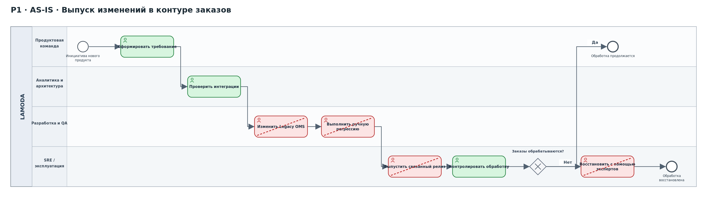
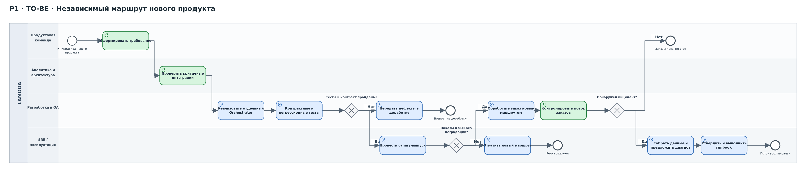
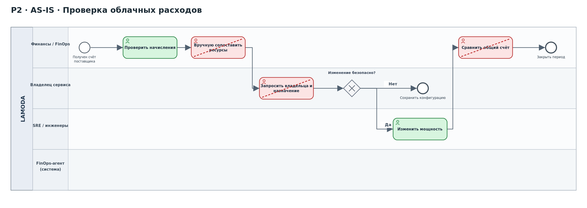
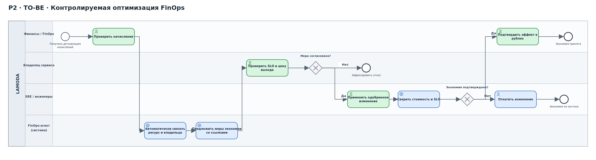

# Lamoda: перепроектирование процессов обработки заказов и управления облачными расходами

## Паспорт проекта

| № | Параметр | Значение |
|---:|---|---|
| 1 | **Бизнес** | Lamoda (ООО «Купишуз»), электронная коммерция и fashion-ритейл |
| 2 | **Масштаб** | 117,6 млрд ₽ выручки ООО «Купишуз» за 2025 год, бухгалтерская отчётность по РСБУ [1] |
| 3 | **Направления выручки** | Продажа собственного ассортимента, маркетплейс сторонних продавцов, услуги продавцам; маркетплейс — 57% NMV в 2025 году [2] |
| 4 | **ИТ-функция** | Более 1300 сотрудников Lamoda Tech; состояние — партнёр, зона 🔴 после первого сценарного эпизода [3] |
| 5 | **Ограничения на раскрытие** | Структура выручки по направлениям, полный состав внутренних систем, ИТ-бюджет, детализация облачных расходов и фактические процессные замеры публично не раскрываются |

## 1. Управленческое резюме и границы анализа

К перепроектированию приняты два процесса:

| Процесс | Бизнес-обязательство | Связь с активной инициативой | Исходная проблема |
|---|---|---|---|
| **P1. Выпуск функциональности нового продукта в контуре обработки заказов и обеспечение непрерывности заказов** | Начать продажи нового продукта без повторной блокировки на неподдерживаемой системе | **H3 — New Order Orchestrator** | По сценарию №57 обработка заказов была остановлена на **24 часа**, запуск продукта перенесён на **6 месяцев**; оба значения — состоявшийся сценарный исход, а не статистика доступности Lamoda |
| **P2. Выявление, согласование и внедрение оптимизаций облачных расходов** | Уменьшить сопоставимые расходы, не ухудшая надёжность заказов и условия выхода от поставщика | **H4 — FinOps** | По сценарию №42 тариф критичного поставщика вырос на **25%** при продлении на пять лет; абсолютный платёж не раскрыт |

Гипотеза **H1 (рекомендация размера и сокращение возвратов)** остаётся в активном портфеле, но не включается в текущий контур перепроектирования: одновременно выполняются два процесса, непосредственно снимающие ограничения для стратегического продукта и защищённого ИТ-бюджета. Её отдельный процесс — «оформление покупки → получение рекомендации размера → выкуп / возврат» — сохраняется для следующей волны изменений.

**Основание модели.** Lamoda публично описывает Order Management как начало складского исполнения заказа [4]. В материалах Lamoda Tech также описаны фактическое отделение функций от монолита, событийная обработка, идемпотентность, поэтапное переключение трафика и проведение технического анализа после инцидентов [5]. **Однако полный внутренний маршрут согласования изменений, состав Legacy OMS и реальный процесс FinOps не опубликованы.** Поэтому организационные шаги AS-IS ниже являются **рабочей процессной моделью, требующей верификации по журналам**, а не утверждением о фактически принятых в Lamoda внутренних регламентах. Данные о 24-часовом простое и +25% относятся только к сценарным событиям.

### Правила чтения схем

- **Зелёный** — сохраняемая задача или контрольная точка.
- **Красный** — задача, которую предполагается исключить при перепроектировании; диагональная красная линия отмечает устранение. Если AS-IS не подтверждён, исключение считается условным.
- **Синий** — новая задача или автоматизация в TO-BE.
- **Серый ромб с маркером X** — исключающий шлюз (XOR), выбор одного из вариантов.

Диаграммы подготовлены в **BPMN 2.0**: один пул **Lamoda** отражает участника процесса; дорожки (*lanes*) разделяют ответственность внутренних ролей и ИТ-систем. События показаны окружностями, задачи — скруглёнными прямоугольниками, исключающие шлюзы — ромбами с маркером X; стрелки внутри пула являются потоками управления (*sequence flow*). Отдельные пулы и потоки сообщений понадобятся при включении в модель самостоятельных внешних участников, например облачного поставщика. Исходные модели в формате `.bpmn` редактируются в совместимых BPMN-редакторах; PNG и SVG используются для просмотра в отчёте.

Цвета задач — дополнительная аналитическая разметка изменений, а не самостоятельные символы BPMN. Устраняемые задачи показаны на диаграммах AS-IS, в TO-BE они отсутствуют. Сохраняемые задачи выделены зелёным, добавляемые — синим.

---

## 2. Процесс P1 — выпуск изменений в контуре заказов (H3)

### 2.1. Цель и подтверждённая исходная точка

**Бизнес-результат:** запуск нового продукта не зависит от внесения существенных изменений в неподдерживаемое ядро заказов. При сбое существующего компонента компания должна безопасно продолжать обработку тех заказов, для которых предусмотрен независимый маршрут, либо быстро восстанавливать обслуживание без потери и дублирования платежей.

Подтверждено сценарием: **24 часа прекращения обработки заказов** и **перенос запуска на 6 месяцев**. Не подтверждены: средняя длительность разработки/согласования релиза, время каждого этапа восстановления, частота сбоев и доля нового продуктового функционала, технически независимая от Legacy OMS.

Целевое время восстановления **RTO ≤4 часа** — ранее принятое **управленческое требование**, не достигнутый показатель Lamoda. Целевое **RPO ≤5 минут** также является требованием к проекту; достижимость проверяется тестовым восстановлением. Неподдерживаемую систему нельзя считать заменённой только по факту появления оркестратора: для заявленной независимости новый маршрут должен пройти весь критичный путь, включая подтверждение наличия, платёжное состояние и передачу исполнения, **без обязательного синхронного обращения к Legacy OMS**.

### 2.2. AS-IS: зависимый маршрут изменений

*Один пул Lamoda, четыре дорожки: продуктовая команда; аналитика и архитектура; разработка и QA; SRE / эксплуатация. Красным отмечены исключаемые действия и зависимости, требующие подтверждения при обследовании.*  

**Границы достоверности:** зависимость от неподдерживаемого компонента и остановка обработки — обстоятельства сценария. Конкретные ручные действия разработки, проверки, релиза и восстановления — проверяемая модель причин задержки; их наличие, частота и длительность **не подтверждены**. Красный цвет означает проектное исключение такой зависимости/повторного ручного труда **если они выявлены при инвентаризации**, а не обвинение существующей команды в ручной работе.

### 2.3. Потери и план исходного замера

Время работы — фактическое активное выполнение задачи сотрудником или системой; время ожидания — интервал, когда запрос или заказ находится без исполнения в очереди, согласовании или при недоступности компонента. Эти величины **не подменяются временем одного известного инцидента**.

| Этап и ответственный                                  | Время работы AS-IS | Время ожидания AS-IS | Потеря / её статус                                                                                                          | Где и как измерить; владелец                                                                              |
| ----------------------------------------------------- | ------------------ | -------------------- | --------------------------------------------------------------------------------------------------------------------------- | --------------------------------------------------------------------------------------------------------- |
| P1.1 Требование → техническая оценка, Product/Analyst | Не раскрыто        | Не раскрыто          | Очередь до оценки — **не подтверждена**                                                                                     | Work item: `created_at → assessment_started_at`, worklog; **Product lead**, последние 90 календарных дней |
| P1.2 Оценка → согласование зависимостей, Architect    | Не раскрыто        | Не раскрыто          | Ручное согласование из-за связанности — **гипотеза**                                                                        | Трекер изменений + архитектурные решения: `ready_for_review → approved`; **CTO / Architect**              |
| P1.3 Реализация и тестирование, Dev/QA                | Не раскрыто        | Не раскрыто          | Повторная регрессия Legacy OMS — **гипотеза**                                                                               | GitLab/CI: `commit`, запуск/окончание pipeline, worklog; **Engineering lead / QA lead**                   |
| P1.4 Одобрение и выпуск, Change owner/SRE             | Не раскрыто        | Не раскрыто          | Ожидание релиза/окна — **гипотеза**                                                                                         | Журнал изменений и deployments; **Release manager**                                                       |
| P1.5 Исполнение заказа, Order services/WMS            | Не раскрыто        | Не раскрыто          | Блокировка при недоступности OMS — **сценарный факт**                                                                       | `order_accepted → fulfillment_accepted`; event log + WMS; **COO / Order product owner**                   |
| P1.6 Восстановление критичного отказа, SRE/Operations | **Не разделено**   | **Не разделено**     | **24 часа полной недоступности обработки заказов — факт одного исхода; это сумма неразделённых работ/ожиданий, не среднее** | Incident start/end, алерты, журнал восстановления, очередь заказов; **Incident commander**                |

**Обязательный baseline:** технический руководитель и владелец процесса в течение начального периода наблюдения сопоставляют 90 дней карточек задач с git/CI событиями и заказными логами. По инциденту сценария восстанавливают **отдельно** длительность детектирования, диагностики, ожидания полномочий/специалиста, выполнения восстановления, сверки заказов и полного открытия трафика. Если timestamps отсутствуют, величина фиксируется как **неизвестная**, а не заполняется экспертной оценкой.

### 2.4. TO-BE: автономный путь для нового продукта

*Сохраняемые действия отмечены зелёным, новые — синим. Шлюзы показывают отдельные ветви доработки, отката релиза и обработки инцидента.*  

**Изменения по существу:** исключается необходимость внедрять новую бизнес-логику непосредственно в неподдерживаемую систему; регрессионные и контрактные проверки становятся повторяемыми в CI; вводится изолированный canary/rollback; сохраняются бизнес-проверка, контроль исполнения и человеческое решение по критичному инциденту. Новая схема **не гарантирует независимость заранее**: если остатки, платёж или передача заказа по-прежнему синхронно зависят от Legacy OMS, gate `K` запрещает считать H3 подтверждённой.

### 2.5. Практики управления и метрики P1

| Практика | Какое решение меняет | Условие ввода | Владелец и контроль |
|---|---|---|---|
| **ITIL 4 — Change Enablement** [6] | Каждый выпуск меняется с неявного риска общей системы на проверяемую оценку зависимости, плана отката и последствий | Нет контрольного списка критичных интеграций или выпускаются изменения заказов | **CTO / Change owner**: доля релизов с записанным решением и rollback-сценарием |
| **ITIL 4 — Incident Management** | Восстановление ведётся по runbook с командованием инцидентом и сверкой заказов | Произошла недоступность заказов, нарушен SLO | **Head of Operations**: полный incident restoration time; отдельно время обнаружения и ожидания |
| **DevOps / CI-CD** | Контрактные тесты, shadow traffic, последовательное включение и откат заменяют непроверяемое переключение связанного функционала | Новая маршрутизация и миграционный адаптер готовы для теста | **Engineering lead**: change lead time, доля релизов с автоматизированными проверками |
| **DORA** [7] | Измерять скорость изменения и последствия релизов без смешения с отказами поставщика/Legacy OMS | Накоплены данные о производственных deployments | **Engineering lead**: change lead time, deployment frequency, change fail rate, failed deployment recovery time |

**Разделение метрик:** исходные **24 часа** — полная остановка заказного контура после инцидента, **не** DORA `failed deployment recovery time`: нет данных, что отказ вызван релизом. DORA используется отдельно для изменений, а восстановление независимо от причины относится к операционной устойчивости [7].

---

## 3. Процесс P2 — управление облачными расходами (H4)

### 3.1. Бизнес-цель и граница данных

Цель — снизить **сопоставимый** расход ресурсов и частично компенсировать уже состоявшееся подорожание критичного поставщика, не ухудшая SLO заказного контура и не увеличивая технологическую зависимость. В сценарии фактически известны **+25% тарифа** и **пятилетний горизонт**; **исходная сумма договора и фактическая доля простаивающих ресурсов неизвестны**. Имя Yandex Cloud используется как зафиксированное ранее сценарное допущение, а не как подтверждение критичной зависимости реальной Lamoda.

Документация Yandex Cloud описывает разовый и регулярный экспорт детализированных расходов в CSV по ресурсам и датам [8]. FinOps Foundation определяет последовательность Inform → Optimize → Operate, учёт владельцев и работу с аномалиями [9, 10]. Наличие технического инструмента выгрузки **не доказывает**, что Lamoda сейчас выполняет либо не выполняет конкретный FinOps-контроль.

### 3.2. AS-IS: контроль стоимости без подтверждённой обратной связи

*Один пул Lamoda; дорожки Finance/FinOps, владелец сервиса, SRE/инженеры, агент. Агент в AS-IS отсутствует; красным отмечены устраняемые ручные действия при подтверждении их наличия.*  

Этапы ручной сводки и переписки — **предположения для проверки**, а не публично установленный способ работы Lamoda. Если инвентаризация подтвердит, что allocation, автоматические уведомления и нормализация затрат уже работают, красные этапы исключаются из программы: повторное внедрение не создаёт эффекта.

### 3.3. Потери и исходный замер

| Этап и роль | Время работы AS-IS | Время ожидания AS-IS | Предполагаемая потеря | Источник данных и владелец |
|---|---|---|---|---|
| P2.1 Получение детализации, Finance | Не раскрыто | Не раскрыто | Задержка получения данных; **не подтверждена** | `period_end → cost_data_available_at` и billing export; **Finance / Billing owner** |
| P2.2 Разнесение по командам, FinOps | Не раскрыто | Не раскрыто | Ручной маппинг ресурсов; **не подтверждён** | Доля расходов с owner/tag, журнал allocation и worklogs; **FinOps lead** |
| P2.3 Поиск причины аномалии, Platform | Не раскрыто | Не раскрыто | Повторная диагностика, неизвестные владельцы | Alert create/ack/triage timestamps, resource utilization; **Platform lead** |
| P2.4 Согласование изменения, Owner/SRE | Не раскрыто | Не раскрыто | Задержка между предложением и одобрением | Ticket transitions и approval log; **Service owner** |
| P2.5 Изменение и проверка, SRE/Finance | Не раскрыто | Не раскрыто | Ложная экономия при снижении трафика или деградации SLO | События deployments/changes + метрики нагрузки + billing line items; **SRE + CFO** |

**Исходный срез:** 2 завершённых последовательных биллинговых месяца (выбор периода — требование к наблюдению, а не известный срок работы Lamoda), дополнительно проверка сезонного отклонения на доступной истории 12 месяцев. Финансовый владелец выгружает `cost, resource_id, date, SKU, project`, Platform — владельца и utilization, SRE — SLO, продуктовая команда — число успешных заказов/единиц полезной нагрузки. Для каждого тикета сохраняются `created_at`, `triaged_at`, `approved_at`, `started_at`, `completed_at`. Отдельно вычисляются **активные минуты работы** по worklog и **минуты ожидания** между статусами. До снятия этих данных абсолютное сокращение времени процесса не утверждается.

### 3.4. TO-BE: непрерывный цикл FinOps с контролем изменений

*Агент только подготавливает рекомендации; владелец сервиса принимает решение; инженеры применяют или откатывают изменение; финансовая функция подтверждает эффект.*  

**Принцип управления:** агент ничего не отключает. На Tier-1 ресурсе решение принимает владелец сервиса вместе с SRE; изменение проходит Change Enablement с rollback. Для высокорисковых инфраструктурных оптимизаций вводится проверка на одновременное влияние на H3 — **нельзя уменьшать ресурс, без которого выполняется приём и восстановление заказов**.

### 3.5. Изменяемые практики P2

| Практика | Изменение процесса | Проверяемый результат |
|---|---|---|
| **FinOps Allocation** [10] | Переход от несвязанной суммы расходов к явным владельцам ресурсов, сервисам и cost centers | Доля `allocated_cost / total_cost` по критичному поставщику; покрытие проверяется на 100% для области пилота |
| **FinOps Anomaly Management** [11] | Сигнал об отклонении связывается с владельцем и записью об изменении; каждое отклонение закрывается с причиной | `anomaly_detected_at → triaged_at`, доля обработанных алертов, подтверждённая предотвращённая стоимость |
| **FinOps Usage Optimization** [9] | Оптимизировать потребление при сохранении производительности, а не экономить только за счёт тарифных скидок | Стоимость на сопоставимую единицу полезной нагрузки |
| **ITIL 4 Change Enablement** [6] | Явное согласование критичных оптимизаций и план отката | Change fail rate для FinOps-изменений, число откатов, инциденты |
| **DevOps/CI** | Применять одобренные конфигурации через воспроизводимую инфраструктурную конфигурацию, затем сравнивать метрики | Изменение подтверждено журналом, повторно применимо или откатываемо |

---

## 4. Агент: вход, решение, ответственность, отказ

Вводятся два **вспомогательных** применения агента. Сбор и суммаризация данных делегируются, утверждение изменения и восстановление работоспособности — **не делегируются**.

| Вопрос управления | P1: агент сопровождения заказного контура | P2: FinOps-агент |
|---|---|---|
| **Задача** | Сопоставить алерт с релизом, трассировкой заказа, журналами и runbook; предложить гипотезу отказа и последовательность проверок | Найти нерентабельные/аномальные ресурсы и составить карточку `стоимость → нагрузка → риск → рекомендация` |
| **Входы и доступ** | Read-only observability, журнал инцидентов и изменений, CI/CD metadata, обезличенные идентификаторы заказов; **без доступа к платёжным реквизитам и PII** | Read-only Billing export, inventory/tags, monitoring и SLO; **без права менять ресурсы** |
| **Выход и след** | Черновик incident summary, список ссылок на доказательства, предложенный runbook и перечень неизвестного; журнал версии рекомендаций | Карточка оптимизации с `resource_id`, текущей стоимостью, владельцем, возможной экономией, SLO и ссылками; журнал рекомендаций |
| **Кто принимает результат** | Incident commander и SRE; операции выполняет назначенный инженер | FinOps lead проверяет арифметику; service owner + SRE одобряют изменение; CFO/Finance подтверждает фактическую экономию |
| **При отказе/ошибке** | Агент недоступен или вывод противоречив → обычный runbook без агента; никакого автоматического удаления заказов, рестартов и платежных операций | Нет owner/SLO, агент ошибся или API недоступен → рекомендация помечается `недостаточно данных`, изменение не проводится; инженер возвращается к ручной проверке |
| **Граница безопасности** | Чтение минимально необходимых данных, аудит, отсутствие write-доступа в prod; действия исключительно через разрешённые операции человека | Разделение прав `read billing` и `modify infrastructure`, аудит обоснования и согласований |

**Приёмочные проверки агента:** на сохранённых исторических кейсах владелец проверяет правильность ссылок на данные, полноту предложенных причин и отсутствие опасных команд. Доля неверных рекомендаций определяется как `непринятые по фактической ошибке / все проверенные рекомендации`, а **не назначается экспертно**. Агент считается полезным только при сокращении проверяемого рабочего времени без ухудшения качества решения; если результата нет, процесс сохраняет неагентный путь.

---

## 5. Количественный эффект и компромиссы

### 5.1. P1: время недоступности и экономический масштаб

**Факт исхода:** `T_incident_before = 24 ч` — один сценарный инцидент, а не среднее MTTR за год.

**Цель совета:** `RTO_target = 4 ч` — управленческий порог, требующий проверки.

Если восстановление при эквивалентном отказе достигнет цели, предельное снижение времени простоя **для одного сопоставимого случая** составит:

`ΔT = 24 − 4 = 20 часов`, или `(24 − 4) / 24 × 100% = 83,33%`.

Это **расчётный условный эффект**, а не заявленный достигнутый результат. Для нового маршрута заказов требуется доказать независимость на тестовом отказе Legacy OMS; фактическая динамика годовой доступности и частота инцидентов неизвестны.

По финансовой базе 2025 года [1] среднедневная выручка составляет:

`117,6 млрд ₽ / 365 дней = 322,19 млн ₽/день`.

При пропорциональном распределении суток за **20 часов** проходит в среднем `322,19 × 20 / 24 = 268,49 млн ₽` выручки. Это **масштаб выручки, экспонированной риску**, а **не предотвращённый убыток или прирост выручки**: часть заказов может быть перенесена, конверсия распродажи выше средней, а маржа и восстанавливаемость заказов неизвестны.

Для денежной оценки нужны `λ_t` (фактический поток заказов во время сбоя), `p_conversion_loss` (доля необратимых потерь), `net_revenue_per_order`, `gross_contribution_margin`. Тогда:

`избежанные безвозвратные потери = ∑_t(успешно восстановленные дополнительные заказы_t × net_revenue_per_order_t × contribution_margin_t)`.

В инвестиционное решение **не** включается вся среднедневная выручка как предотвращённая потеря. Ожидаемая выручка нового продукта также **не определяется из одного факта переноса запуска на 6 месяцев** — требуется коммерческий бизнес-кейс H3.

**Проверка TO-BE:** на изолированном test/staging стенде остановить Legacy OMS, сохранить поток тестовых заказов, проверить: нет ли синхронной зависимости на critical path, все заказы сверены, дублированных платежей нет, полное восстановление укладывается в 4 часа. В промышленном canary — отдельные показатели времени от входа заказа до принятия WMS и доля failed orders.

### 5.2. P2: стоимость потребления и возврат инвестиций

Пусть `C_old` — подтверждённые годовые расходы на критичного поставщика до повышения. По сценарию `C_new = 1,25 × C_old`.

Управленческий ориентир H4 — снизить новый сопоставимый расход на **5%** при сохранении SLO. Это соответствует:

`Saving_target = 0,05 × C_new = 0,0625 × C_old`;

`Saving_target / (C_new − C_old) = 0,0625 / 0,25 = 25%`.

То есть при выполнении ориентира компенсируется **четверть тарифной надбавки**, а не четверть всех затрат компании. Значение **5% — целевой порог, выведенный из решения компенсировать четверть надбавки; не доказанный потенциал экономии**.

**Правило сравнения:** стоимость сравнивается при равной полезной нагрузке и неизменных SLO, а изменение цены отделяется от изменения объёма. Для одной сопоставимой категории использования:

`UnitCost_before = Cost_before / Workload_before`, `UnitCost_after = Cost_after / Workload_after`,

`Saving_observed = 1 − UnitCost_after / UnitCost_before`.

Для смешанного портфеля — расчёт по одинаковым SKU/сервисам и фиксированному набору workload, с отдельным учётом новых продуктов. Простой спад затрат на фоне уменьшения заказов **не засчитывается**.

**Нижняя оценка прямого труда первичного пилота**, согласованная с действующим планом H4: **2 специалиста × 2 месяца × 270 000 ₽/мес. = 1,08 млн ₽**. 270 тыс. ₽ — опубликованная медиана **зарплаты разработчиков Москвы** [12], а не полная стоимость FinOps/SRE и не оклад сотрудников Lamoda. Не включены налоги/взносы, лицензии, создание отчётности и поддержка, поэтому **1,08 млн ₽ — нижняя прокси-граница, не полный бюджет**.

Только по этой нижней границе первый год окупает труд пилота при:

`C_old > 1,08 млн ₽ / 0,0625 = 17,28 млн ₽/год`.

**Полное условие окупаемости** — `0,0625 × C_old > 1,08 млн ₽ + Extra_tools + Loaded_labor_delta + Ongoing_run_cost`. Все правые неизвестные должны быть подтверждены CFO/CTO. При невыполнении условия оптимизации без положительного чистого эффекта не утверждаются.

### 5.3. Что может ухудшиться

| Решение | Потенциальный trade-off | Предохранитель и условие остановки | Источник проверки |
|---|---|---|---|
| Вывод логики заказов в Orchestrator | Больше межсервисных вызовов, риск дублей/расхождения платежей и остатков, новая точка отказа | 0 двойных платежей и 0 необъяснённых расхождений в тестовом наборе; при нарушении — **остановка rollout и откат** | Reconciliation лог заказов/платежей, трассировки, error budget |
| Canary и проверки перед релизом | На первом этапе увеличивается труд разработки и ожидание quality gate | При росте change lead time без снижения failure rate — анализировать bottleneck и менять набор проверок, а не отключать контроль автоматически | CI/CD, change tickets, DORA метрики |
| Автоматические рекомендации FinOps | Ложные рекомендации и дополнительный поток задач инженерам | Отключить рекомендацию для неподтверждённого owner/SLO; оценивать precision по проверенным кейсам | Реестр agent proposals / approvals |
| Сокращение облачного потребления | Меньше запас мощности на распродажах, рост latency, риск повторного сбоя | SLO и capacity tests обязательны; при деградации — откат до подтверждения экономии | Мониторинг, нагрузочные тесты, пострелизные метрики |
| Более дешёвый vendor-specific тариф | Увеличение lock-in и стоимости выхода от поставщика | Запрет оптимизаций, нарушающих согласованную стратегию переносимости; отдельный review архитектуры | CTO / CRO, карта зависимостей, exit plan |

---

## 6. Порядок внедрения и принятия решений

| Этап | Содержание | Владелец | Условие перехода |
|---|---|---|---|
| **G0. Верификация AS-IS** | Снять baseline, проверить реальное наличие ручных шагов и зависимости Legacy OMS, собрать облачный bill и владельцев | Product lead + Engineering lead + Finance | Для каждого заявленного узкого места есть запись, журнал либо отметка «не подтверждено» |
| **G1. Проверка архитектуры H3** | Contract tests, изоляция Legacy OMS, интеграционные проверки, регистр критичных зависимостей | CTO / Architect | В заказном critical path нового продукта нет обязательного синхронного вызова Legacy OMS |
| **G2. Тест отказа и восстановления** | Смоделировать отказ, проверить runbook, сверку заказов/платежей и rollback | Incident commander / SRE | Испытание подтверждает целевой RTO ≤4 ч, RPO ≤5 мин и отсутствие дублированных платежей |
| **G3. Ограниченное переключение H3** | Shadow и canary по решению владельца продукта | Product owner + SRE | Нет Sev-1, ошибки и бизнес-метрики не хуже заранее установленного baseline; иначе rollback |
| **F1. Биллинг H4** | Поресурсная выгрузка, allocation, workload/SLO baseline | CFO + FinOps lead | Сопоставимы расходы, владельцы и стоимость единицы полезной нагрузки |
| **F2. Контролируемая оптимизация** | Агент предлагает, владелец утверждает, SRE меняет и проверяет | Service owner + SRE | Реальная экономия подтверждена; SLO сохранён; полный TCO и exit-risk не ухудшены |

**Управление конфликтом двух сценариев:** изменения в инфраструктуре, на которой отрабатывается новый маршрут заказов, замораживаются на период его нагрузочных и отказоустойчивых тестов. FinOps не использует критичных специалистов H3 без согласования CTO. Снижение расходов на поставщика не может быть получено за счёт снижения резервирования, необходимого для выполнения заказов.

---

## 7. Реестр исходных данных и неопределённостей

| ID | Данные / параметр | Значение и тип | Откуда | Уверенность | Способ подтверждения / владелец |
|---|---|---|---|---|---|
| D1 | Выручка ООО «Купишуз» 2025 | **117,6 млрд ₽**, факт | Публичная отчётность [1] | Высокая для РСБУ | Finance: единый периметр расчёта |
| D2 | Суточный отказ Legacy OMS | **24 часа**, сценарный исход | Эпизод №57 | Высокая внутри сценария; не факт о реальной Lamoda | Incident commander: восстановить timeline |
| D3 | Перенос запуска продукта | **6 месяцев**, сценарный исход | Эпизод №57 | Высокая внутри сценария | Product owner: план запуска и причины задержки |
| D4 | Рост цены поставщика | **+25%**, пятилетний договор, сценарный исход | Эпизод №42 | Высокая внутри сценария | CFO: договор, SKU, индексация |
| D5 | Исходная сумма договора `C_old` | Не раскрыта | В сценарии только процент изменения | Не установлена | Finance: подписанный договор и billing export [8] |
| D6 | Yandex Cloud как критичный поставщик | Сценарная привязка, не подтверждённая публичная доля систем | Принятое управленческое допущение | Условная | CTO + Vendor manager: карта критичных нагрузок |
| D7 | Внутренний AS-IS P1: ручной цикл согласования/релиза | Проверяемая рабочая модель | Сценарий подтверждает зависимость, не детали процесса | Низкая | Workflows + CI/CD + интервью инженерных команд |
| D8 | Внутренний AS-IS P2: ручная аллокация/согласование | Проверяемая рабочая модель | Публичных регламентов Lamoda нет | Низкая | FinOps/Finance discovery: billing, tickets, allocation |
| D9 | Длительности работы и ожидания по шагам | Неизвестны, **не заменяются экспертными часами** | Корпоративные таймстемпы недоступны | Не установлена | Снять отдельно по указанным выше системам за наблюдаемый период |
| D10 | RTO ≤4 ч, RPO ≤5 мин | **Целевые SLO**, не факт достигнутого результата | Управленческое решение по сценарию №57 | Высокая как формальная цель; достижимость неизвестна | Recovery drill, журналы и сверка |
| D11 | Доля снижения облачных затрат | **5%**, управленческая цель | `5% × 1,25 / 0,25 = 25%` компенсации повышения | Арифметика высокая, достижимость неизвестна | Пилот при сопоставимой нагрузке |
| D12 | Прокси зарплаты | 270 тыс. ₽/мес. разработчика в Москве | Хабр Карьера, первое полугодие 2026 [12] | Средняя применимость к разным ролям | Finance: полная ставка каждой роли |
| D13 | Пилот H4 | 2 FTE × 2 мес. × 270 тыс. = **1,08 млн ₽**, неполная стоимость зарплат | Принятый объём диагностического пилота + [12] | Средняя по порядку, не full TCO | Engineering resource plan, налоги, сервисы, лицензии |
| D14 | Нормировка облачных расходов | `cost / comparable workload`, без абсолютного baseline | Публичной выгрузки Lamoda нет | Метод известен, значения неизвестны | CFO+SRE: отдельные когорты сервисов и заказов |
| D15 | Частота отказов и предотвращённая выручка | Неизвестны; один инцидент не задаёт вероятности | Недостаточно выборки | Не установлена | Несколько периодов инцидентов + бизнес-метрики продаж |
| D16 | Данные агентных решений | Пока отсутствуют, система предлагается к внедрению | Проект процесса | Не установлена | Историческая validation выборка, feedback от экспертов |

---

## 8. Источники

1. **Xfirm — ООО «Купишуз», отчётность по данным ФНС и Росстата.** Выручка за 2025 год: 117 587 001 000 ₽. https://xfirm.ru/company/7705935687
2. **Retail.ru — Lamoda Business.** Доля маркетплейса в NMV за 2025 год — 57%. https://www.retail.ru/news/dlya-raboty-s-sellerami-kompaniya-lamoda-sozdala-brend-lamoda-business-29-aprelya-2026-277300/
3. **Lamoda Tech — компания и команда.** Публичные сведения о технологической функции. https://habr.com/ru/companies/lamoda/
4. **Lamoda Tech — «От монолита к модулям: как отстроены бизнес-процессы склада Lamoda».** Order Management начинает складскую обработку заказа; связи с WMS. https://habr.com/ru/companies/lamoda/articles/548554/
5. **Lamoda Tech — «Как бизнес-требования диктуют архитектуру: эволюция сервиса уведомлений».** Поэтапный вывод функций из монолита, Kafka, оркестрация, идемпотентность, события и реальные инциденты. https://habr.com/ru/companies/lamoda/articles/956848/
6. **PeopleCert / AXELOS — ITIL 4 Practitioner: Change Enablement.** Оценка рисков, авторизация и календарь изменений. https://www.axelos.com/certifications/itil-service-management/itil-practices-manager/itil-4-specialist-plan-implement-and-control/itil-4-practitioner-change-enablement/
7. **DORA — история метрик software delivery (обновление 2026).** Различие между failed deployment recovery time и восстановлением после иных сбоев. https://dora.dev/insights/dora-metrics-history/
8. **Yandex Cloud — экспортировать расширенную детализацию.** Поресурсные CSV, регулярная выгрузка, период начисления, расход по ресурсам. https://yandex.cloud/ru/docs/billing/operations/get-folder-report
9. **FinOps Foundation — фазы Inform, Optimize, Operate.** Принципы сравнимого облачного потребления и внедрения мер оптимизации. https://www.finops.org/framework/phases/
10. **FinOps Foundation — Allocation.** Разнесение технологических затрат по владельцам ресурсов, командам и продуктам. https://www.finops.org/framework/capabilities/allocation/
11. **FinOps Foundation — Anomaly Management.** Выявление аномалий, связь с владельцами и журналами изменений. https://www.finops.org/framework/capabilities/anomaly-management/
12. **Хабр Карьера — «Сколько зарабатывают разработчики в 2026 году».** Медиана зарплат московских разработчиков — 270 тыс. ₽/мес. https://habr.com/ru/companies/habr_career/articles/1075936/

---

## 9. Решение

1. **По заказам:** развивать отдельный маршрут нового продукта только при доказанной независимости его критичных операций от Legacy OMS. Сохранить контроль Product/Operations, внедрить контрактные проверки, поэтапный rollout и восстановление по runbook. До промышленного переключения подтвердить RTO ≤4 ч и безопасность расчётов.
2. **По облаку:** внедрить проверяемый FinOps-цикл на данных биллинга и фактической нагрузки. Оптимизации выполняются только после человеческого согласования, проверки SLO и независимости от критичных зависимостей H3. Экономия 5% — условная цель, а не уже полученный результат.
3. **По данным:** не утверждать абсолютную сумму экономии и среднее время операций, пока не получены внутренние исходные показатели. Первым контрольным результатом считается **подтверждённый AS-IS с отдельно измеренными временем работы и временем ожидания**.
